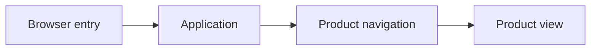

# Architecture Overview

BERT Attention Visualizer renders its application and navigation in the browser.

- Related implementation: [Navigation Design](../design/app/10-navigation.md).
- Code: frontend/src/App.tsx, frontend/src/components/GuidePage.tsx, frontend/src/components/layout/AppHeader.tsx, frontend/src/components/layout/InfoPanel.tsx.

## Example
- Input: Open the application.
- Steps: Render the application and select a supported navigation item.
- Expected result: The corresponding product view opens.

